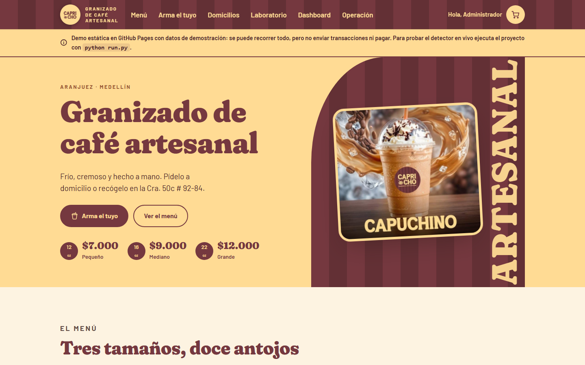
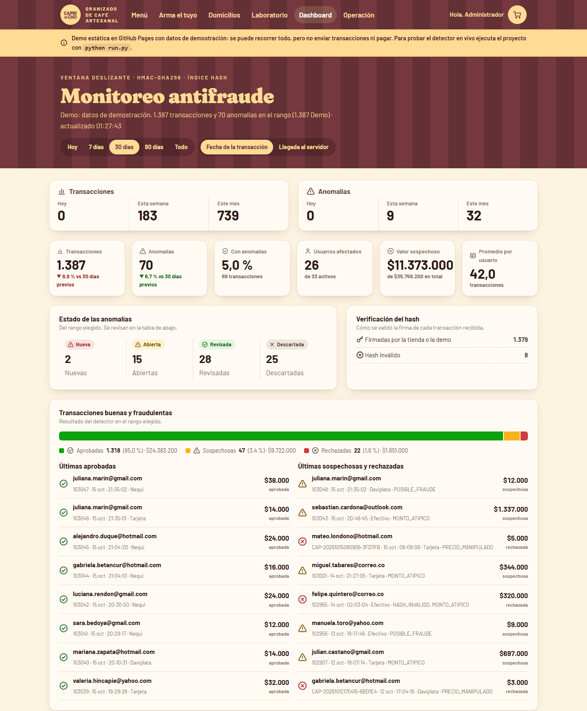
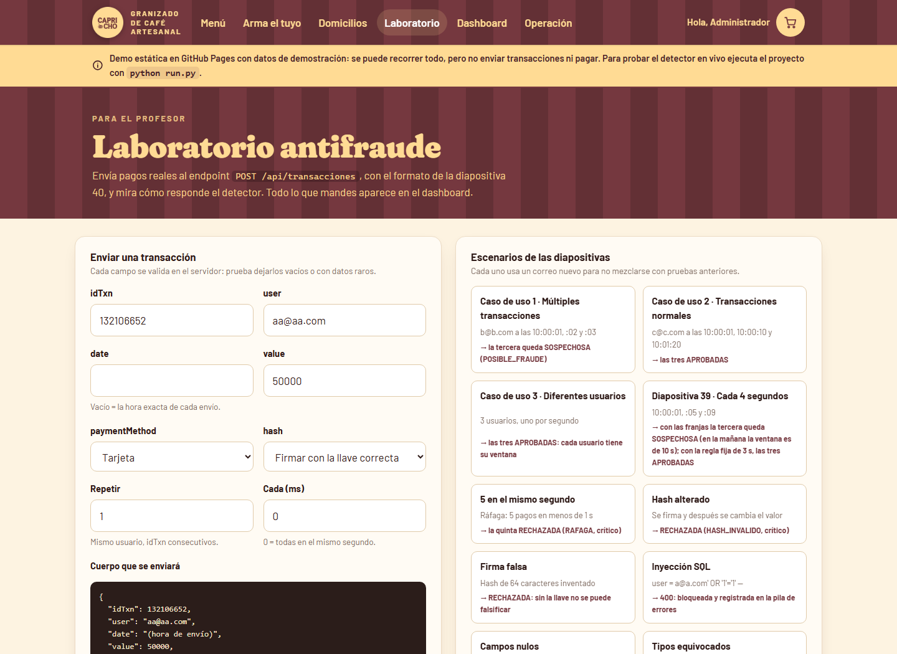
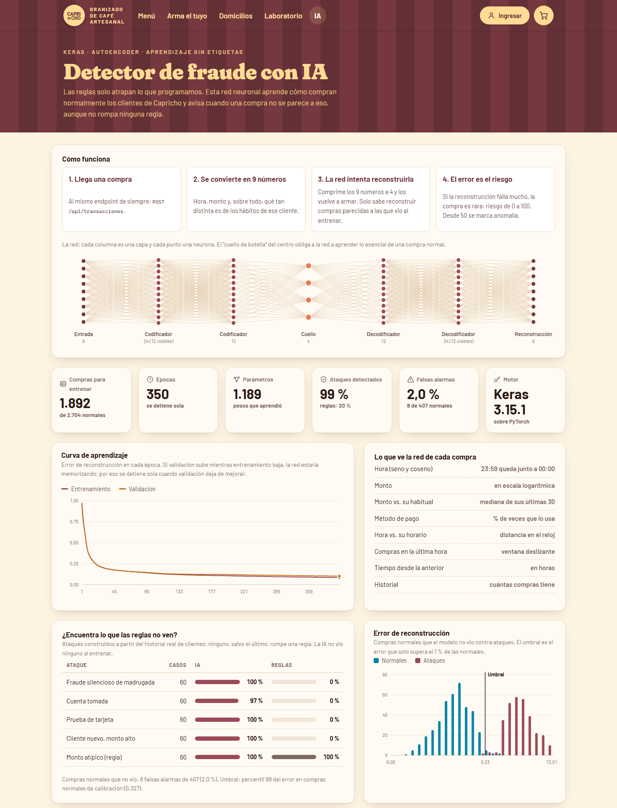

# Capricho — Granizado de café artesanal

Plataforma de **Capricho** (Aranjuez, Cra. 50c # 92-84, Medellín) que opera el
negocio (usuarios, categorías, ítems con inventario, pedidos de todos los
canales, facturas y pagos) y además **valida, protege y analiza** cada
operación: limpieza de datos, hash encadenado, algoritmos medidos
experimentalmente, estadística por usuario e **inteligencia artificial sin LLM**
(Keras y TensorFlow) que clasifica cada operación como normal o fraudulenta.

Proyecto de Programación Avanzada · Institución Universitaria Pascual Bravo.
Resuelve lo que pide *Técnicas de resolución de problemas* (caso Appresso) y
reúne lo mejor de los dos trabajos anteriores:

| Viene de | Qué se usa aquí |
|---|---|
| Trabajo 1 (complejidad) | **Búsqueda por índice hash O(1)**: usuarios por correo y transacciones por `idTxn` |
| Trabajo 2 (estructuras) | **Cola FIFO** para los pedidos, **Pila LIFO** para los errores y **grafo + Dijkstra** para los domicilios |
| Técnicas de resolución | Métodos HTTP, hash HMAC-SHA256, validación, divide y vencerás, búsqueda eficiente, logs y **ventana deslizante** |
| Keras (exposición) | **Autoencoder** que aprende los hábitos de compra y detecta fraudes que ninguna regla ve |
| **Entrega final** | Módulos operativos, limpieza y calidad, integridad, algoritmos O(n)/O(n²)/O(n log n), estadística simple y cuatro modelos de IA |

---

## Entrega final

Cómo se cubre cada criterio de evaluación (el detalle, con cifras, está en
**[INFORME_FINAL.md](INFORME_FINAL.md)** y la guía para presentarlo en
**[EXPOSICION_FINAL.md](EXPOSICION_FINAL.md)**):

| Criterio | Peso | Dónde se ve | Qué hay |
|---|---|---|---|
| Base de datos | 5 % | `capricho/esquema.sql` | 16 tablas con llaves foráneas, CHECK, índices y versión de esquema |
| Módulos operativos | 15 % | `/gestion` | CRUD de usuarios con roles, categorías e ítems; pedidos de varios ítems por canal que descuentan inventario; facturas con consecutivo, impuesto al consumo y descuentos; pagos con comprobante |
| Algoritmos y análisis experimental | 30 % | `/algoritmos` | 8 problemas en O(1), O(log n), O(n), O(n log n) y O(n²), medidos hasta 50.000 datos del sistema, con la complejidad estimada por regresión |
| Limpieza y calidad de datos | 10 % | `/calidad` | Auditoría con puntaje (completitud, validez, unicidad, consistencia), corrección automática e importación de CSV/JSON sucios |
| Integridad | 10 % | `/integridad` | Hash encadenado HMAC-SHA256 de facturas y pagos; comprobantes firmados (falsos, reutilizados o que no coinciden) |
| Modelos de IA | 30 % | `/ia`, `/en-vivo`, `/estadistica` | Clasificador (Keras + TensorFlow), regresión del monto esperado, predicción de demanda, autoencoder y anomalías por usuario con Simple Statistics |

Las dos observaciones del profesor después de la exposición:

1. **Aprender de todos y no solo del historial de cada cliente.** El
   clasificador se entrena con toda la población y sus variables generales
   sirven aunque el cliente sea nuevo: con clientes nuevos detecta el 85 % de
   los fraudes con 100 % de precisión (las reglas, 56 %). Cada decisión dice
   cuánto conocimiento general y cuánto personal usó.
2. **Una transferencia en vivo.** En `/transferir` (también desde un celular
   con ngrok) se hace una transferencia y `/en-vivo` muestra en ese momento cómo
   la analizó cada parte del sistema con lo que aprendió.

---

## Demo en línea

**[samuelvelez-g.github.io/CAPRICHO](https://samuelvelez-g.github.io/CAPRICHO/)**

Versión estática publicada con GitHub Pages: la tienda, el panel, el
dashboard, los algoritmos, la calidad, la integridad, la estadística y los
modelos de IA con los mismos estilos, recorribles con datos de demostración. Como GitHub Pages no ejecuta Python, ahí no se pueden enviar
transacciones ni pagar; para el sistema completo (endpoint, detector en vivo,
base de datos) hay que ejecutar el proyecto como se explica abajo.

| Tienda | Dashboard antifraude |
|---|---|
| [](https://samuelvelez-g.github.io/CAPRICHO/) | [](https://samuelvelez-g.github.io/CAPRICHO/dashboard.html) |

| Laboratorio | Detector con IA (Keras) |
|---|---|
| [](https://samuelvelez-g.github.io/CAPRICHO/laboratorio.html) | [](https://samuelvelez-g.github.io/CAPRICHO/ia.html) |

---

## Cómo ejecutarlo

Necesita **Python 3.12** (TensorFlow 2.21 funciona con Python 3.10 a 3.13).
En Windows se instala con `pymanager install 3.12`.

```bash
py -3.12 -m venv .venv
```

En Windows:

```bash
.venv\Scripts\activate
```

En Mac o Linux:

```bash
source .venv/bin/activate
```

Después:

```bash
pip install -r requirements.txt
```

```bash
python run.py
```

Abre **http://127.0.0.1:5000**. La primera vez se crea la base de datos
(`instancia/capricho.db`) con 9 semanas de operación de demostración. Al
arrancar debe decir `IA (Keras): clasificador, autoencoder, monto esperado,
demanda sobre tensorflow`; si dice `DESACTIVADA`, el entorno `.venv` no está
activado. Una base de una versión anterior se guarda sola como respaldo.

| Rol | Correo | Contraseña |
|---|---|---|
| Administrador (todo) | `admin@capricho.co` | `Capricho2026*` |
| Empleada de caja (gestión) | `caja@capricho.co` | `Caja2026*` |
| Cliente de prueba | `cliente@capricho.co` | `Cliente2026*` |

Para empezar de cero con 9 semanas de datos de demostración nuevos:

```bash
python run.py --reiniciar
```

Para la **prueba del profesor**: base de datos sin transacciones (solo productos
y cuentas), así el dashboard muestra únicamente lo que él envíe:

```bash
python run.py --reiniciar --limpio
```

Pruebas automáticas (86 pruebas: casos de uso, franjas, formatos del generador, datos en vivo y demo, IA, caja,
facturas, comprobantes, hash encadenado, roles, calidad, algoritmos, estadística, transferencia en vivo y seguridad):

```bash
python -m unittest discover -s tests -t .
```

Volver a entrenar los modelos (unos 2 minutos; ya vienen entrenados en `capricho/ia/artefactos/`):

```bash
python herramientas/entrenar_modelos.py --todo
```

Benchmark completo de los algoritmos (unos 30 s; escribe `docs/INFORME_ALGORITMOS.md`):

```bash
python herramientas/benchmark.py
```

---

## URL pública con ngrok (para la prueba del profesor)

El generador del profesor envía las transacciones desde su equipo, así que el
endpoint necesita una URL pública. Con el servidor corriendo en una terminal:

1. Crear una cuenta gratis en ngrok.com y copiar el *authtoken* del panel.
2. Instalar ngrok (una sola vez): `winget install Ngrok.Ngrok`
3. Registrar el token (una sola vez): `ngrok config add-authtoken TU_TOKEN`
4. En otra terminal: `ngrok http 5000`
5. Copiar la línea `Forwarding https://xxxx.ngrok-free.app` y darle al profesor
   **`https://xxxx.ngrok-free.app/api/transacciones`**.

Mientras corre, **http://127.0.0.1:4040** muestra cada petición que llega por
el túnel con su cuerpo y la respuesta: sirve para ver en vivo qué manda el
generador. La URL cambia cada vez que se reinicia ngrok (salvo que se use el
dominio fijo gratuito del panel). Las dos terminales y el computador deben
quedar encendidos durante la prueba.

Alternativa sin cuenta: `cloudflared tunnel --url http://localhost:5000`.

---

## Inteligencia artificial (Keras + TensorFlow)

Cuatro redes neuronales, sin LLM. Todas se entrenan con
`herramientas/entrenar_modelos.py`, se guardan en formato `.keras` y la
aplicación las carga al arrancar. En vivo se ejecutan con NumPy (los mismos
pesos, 160 veces más rápido que llamar a Keras para una sola operación).

| Modelo | Pregunta | Tipo | Resultado en datos que no vio |
|---|---|---|---|
| **Clasificador** (`ia/clasificador.py`) | ¿Esta operación es normal o fraudulenta? | Supervisado, 23 variables → 64 → 32 → 1 | Detecta 90,5 % de los fraudes con 100 % de precisión; con clientes nuevos 85,2 % |
| **Monto esperado** (`ia/monto.py`) | ¿Cuánto debería pagar este cliente? | Regresión | Error típico 45,9 % contra 48,7 % de la mediana del cliente |
| **Autoencoder** (`ia/modelo.py`) | ¿Se parece a los hábitos de ESTE cliente? | Sin etiquetas | El de la exposición |
| **Demanda** (`ia/demanda.py`) | ¿Cuánto se va a vender? | Series de tiempo | Error diario $87.261 contra $103.512 de la regresión lineal |

**Clasificador.** Se entrena con 90 días de una población simulada de 800
clientes con los hábitos de Capricho y 7 tipos de fraude etiquetados
(`ia/simulador.py`), con división temporal (los últimos 14 días solo para
probar). TensorFlow prepara los datos: `keras.layers.Normalization`, y
`tf.data` mezcla y aumenta los fraudes con ruido gaussiano (el aumento sube el
F1 de 0,929 a 0,950). Comparación en prueba:

| Detector | Todos | Clientes nuevos | Precisión | Falsas alarmas |
|---|---|---|---|---|
| Reglas de la primera entrega | 52,7 % | 55,6 % | 100 % | 0 % |
| Autoencoder de la exposición | 71,6 % | 81,5 % | 15,2 % | 3,86 % |
| **Clasificador** | **90,5 %** | **85,2 %** | **100 %** | **0 %** |

Cada decisión trae su explicación: qué variables empujaron hacia fraude o hacia
normal y cuánto conocimiento general (de todos los clientes) y personal (del
historial de ese cliente) usó. Con un cliente nuevo es 100 % general.

**Anomalías por usuario con estadística simple** (`servicios/estadistica.py`):
cuartiles, cercas de Tukey y puntaje z del monto de cada cliente (o de la
población si es nuevo), y tasas diarias de descuentos y anulaciones por
empleado. El panel `/estadistica` lo recalcula en el navegador con la librería
**Simple Statistics** 7.8.8 (`static/js/vendor/`) y muestra que los dos
cálculos coinciden.

En el dashboard, "Reglas de detección", se elige qué hace la IA: **marcar** la
operación como sospechosa, **solo observar** (útil si el generador del
profesor manda montos que no son de una cafetería) o **apagada**.

> Keras 3 corre sobre TensorFlow, JAX o PyTorch con el mismo código. El proyecto
> usa TensorFlow 2.21 (Python 3.12). Si alguien solo tiene Python 3.14, la
> aplicación funciona igual sobre PyTorch; solo el reentrenamiento exige TensorFlow.

---

## Datos en vivo y datos de demo

Todo vive en la misma base de datos, pero cada transacción guarda su `origen`:
`API` y `LOTE` (lo que llega al endpoint: el generador del profesor, el
laboratorio), `TIENDA` (compras) y `DEMO` (lo que siembra la demostración).
Arriba del dashboard se elige qué datos ver y **todas** las tarjetas,
gráficas, tablas y la pila de errores usan esa misma elección:

| Datos | Qué incluye |
|---|---|
| **En vivo** (por defecto) | API, lotes y tienda. Nunca mezcla la demo |
| **Demo** | Solo los datos sembrados |
| **Todo** | Ambos, con el conteo por origen en el encabezado |

El rango (hoy, 7, 30, 90 días, todo) y el tipo de fecha (la de la transacción
o la de llegada al servidor) también aplican a todo el dashboard, incluidas las
tablas de anomalías y de transacciones. Para una prueba sin ningún dato de demo:
`python run.py --reiniciar --limpio`.

---

## Publicar la demo en GitHub Pages

La carpeta `docs/` es la demo estática. Se vuelve a generar después de cambiar
la aplicación:

```bash
python herramientas/exportar_demo.py
```

El script arranca la app con datos de demostración en una base temporal y
guarda cada página como HTML y cada consulta GET como JSON. En GitHub:
**Settings → Pages → Deploy from a branch → `main` → `/docs` → Save**.

---

## Páginas

| Ruta | Para qué |
|---|---|
| `/` | Tienda: menú, arma tu granizado, mapa de domicilios |
| `/pagar` | Pago del carrito (necesita sesión) |
| `/transferir` | **Transferencia en vivo** desde cualquier dispositivo (también el celular del profesor por ngrok) |
| `/en-vivo` | **Monitor**: cada transferencia que llega y cómo la analizó cada parte del sistema (administrador) |
| `/panel` | Ventas, predicción de demanda, alertas, calidad, modelos y benchmark (administrador) |
| `/gestion` | Caja, facturas, pedidos, ítems con inventario, categorías y usuarios con roles (administrador y empleados) |
| `/calidad` | Auditoría de calidad, corrección automática e importación de archivos sucios (administrador) |
| `/integridad` | Cadena de hashes de facturas y pagos, con laboratorio de alteración (administrador) |
| `/algoritmos` | Benchmark de los algoritmos con gráficas log-log |
| `/estadistica` | Perfil estadístico por usuario y por empleado con Simple Statistics (administrador) |
| `/ia` | Los cuatro modelos: cómo se entrenaron, qué tan bien funcionan y probadores |
| `/laboratorio` | **Para el profesor**: formulario y escenarios para mandar pagos buenos y fraudulentos |
| `/dashboard` | Monitoreo antifraude (administrador) |
| `/operacion` | Cola de pedidos, pila de errores, grafo, búsqueda por índice y CRUD de ítems con los cinco métodos HTTP |

---

## El detector de fraude

Cada transacción llega a `POST /api/transacciones` con el formato de la diapositiva 40:

```json
{
  "idTxn": 10001,
  "user": "aa@aa.com",
  "date": "2026-09-23T10:30:01.120",
  "value": 50000,
  "paymentMethod": "Tarjeta",
  "hash": "ec37a3a3e8e2566a6ae41d5c807d11db5be922a231d..."
}
```

El algoritmo (diapositiva 41), en `capricho/servicios/detector.py`:

1. ¿El `idTxn` ya existe? → **409** (reenvío / *replay*). Se busca en el índice hash, O(1).
2. ¿El hash coincide? Si no → **RECHAZADA**, anomalía `HASH_INVALIDO` (crítica).
3. Se identifica al usuario (índice hash por correo).
4. Se traen **solo** sus transacciones cercanas con el índice `(usuario_id, fecha_txn)` y se corre la ventana deslizante con dos punteros. Cuentan todas, también las de hash inválido: el intento ocurrió.
5. **5 o más en menos de 1 segundo** → **RECHAZADA**, anomalía `RAFAGA` (crítica). Se cuenta con la fecha de cada transacción; opcionalmente también con la hora de llegada al servidor (apagado por defecto, porque un generador que envía muy rápido produciría ráfagas falsas).
6. **Umbral o más dentro de la ventana** → **SOSPECHOSA**, anomalía `POSIBLE_FRAUDE` (media; alta si supera el umbral).
7. Monto igual o mayor a $300.000 → **SOSPECHOSA**, anomalía `MONTO_ATIPICO` (baja).
8. Se registra la transacción y sus anomalías.

Cada usuario tiene su propia ventana (caso de uso 3). Las transacciones pueden
llegar desordenadas: la ventana revisa vecinas antes y después.

La respuesta es **201** siempre que la transacción quedó registrada, sea normal
o fraudulenta (diapositiva 41: "Anomalía → Registrar"). El resultado va en el cuerpo:

```json
{ "ok": true, "resultado": "ANOMALIA", "estado": "SOSPECHOSA", "anomalias": ["POSIBLE_FRAUDE"],
  "transaccion": { "...": "detalle completo y el análisis de la ventana" } }
```

Solo responde error cuando la petición misma está mal: **422** campos nulos o
con formato inválido, **400** inyección SQL, **409** `idTxn` repetido. El
endpoint también acepta una lista de transacciones (se procesa como lote) y las
rutas alternativas `/transacciones` y `/api/transactions`.

### Reglas configurables (PUT y PATCH en `/api/configuracion` o desde el dashboard)

- **Por franja horaria** (por defecto, diapositiva 38): la ventana depende de la
  hora de la transacción, con el umbral de la diapositiva 39 (3 o más):

  | Franja | Horario | Ventana |
  |---|---|---|
  | Mañana | 05:00:01 a 12:00:00 | 10 s |
  | Tarde-noche | 12:00:01 a 20:00:00 | 6 s |
  | Noche-madrugada | 20:00:01 a 05:00:00 | 3 s |

  La diapositiva dice "venta de 10 / 6 / 3": el profesor confirmó que es "ventana".
- **Regla fija** (diapositiva 39): 3 o más transacciones en 3 segundos a cualquier hora.

Cada franja tiene su ventana y su umbral editables desde el dashboard. La franja
se elige con la hora de la transacción que llega (campo `date`).

### Cómo se verifica el hash

Como no sabemos con qué script firma el generador del profesor, el servidor
acepta las formas que muestran las diapositivas y rechaza todo lo demás:

- **HMAC-SHA256** (diapositiva 19) con la llave propia `capricho_llave_secreta_2026`
  o con la de la diapositiva, `mi_llave_privada_123`. Si el profesor da otra
  llave, en PowerShell: `$env:CAPRICHO_LLAVES_EXTRA = "su_llave"` antes de `python run.py`.
- **SHA-256 sin llave** (diapositivas 15 a 17). Se puede exigir solo HMAC con
  `$env:CAPRICHO_SHA256_SIMPLE = "0"`.
- Sobre los 5 campos de la diapositiva 40 o sobre todos los campos menos `hash`,
  con llaves ordenadas (Python) o en el orden recibido (`JSON.stringify` de JavaScript).

Cualquier dato alterado después de firmar cambia el hash y se detecta. El
dashboard muestra en "Verificación del hash" cómo se validó cada transacción.

### Cómo firmar una transacción (diapositiva 19)

```python
import hashlib, hmac, json

LLAVE = b"capricho_llave_secreta_2026"
txn = {"idTxn": 10001, "user": "aa@aa.com", "date": "2026-09-23T10:30:01.120",
       "value": 50000, "paymentMethod": "Tarjeta"}
datos = json.dumps(txn, sort_keys=True, separators=(",", ":"))
txn["hash"] = hmac.new(LLAVE, datos.encode(), hashlib.sha256).hexdigest()
```

O desde la terminal, con el servidor corriendo:

```bash
python herramientas/enviar_transacciones.py --usuario r@r.com --repetir 5 --intervalo 100
```

---

## Seguridad de los formularios

| Requisito | Cómo se cumple |
|---|---|
| Validación en todo | Las mismas reglas en el navegador (`static/js/validacion.js`) y en el servidor (`capricho/validaciones.py`). La del servidor es la que manda. |
| Nombre de más de 3 letras | Solo letras y espacios, mínimo 4 letras (constante `NOMBRE_MIN_LETRAS`). |
| Ningún campo nulo | Todo campo obligatorio se rechaza si llega `null`, vacío o solo con espacios. También se revisan los tipos (`true` no pasa como número). |
| Inyección SQL | Todas las consultas usan parámetros `?`. Además, una capa detecta patrones (`' OR 1=1`, `--`, `UNION SELECT`, `DROP TABLE`…), bloquea con **400** y lo deja en la pila de errores. |
| Contraseñas con hash | `scrypt` con sal aleatoria de 16 bytes. Nunca se guarda la contraseña. Tras 5 intentos fallidos se bloquea 5 minutos. |
| Precio validado en el servidor | El servidor recalcula cada línea con los precios de la base de datos. Si el total del navegador no coincide, la compra se rechaza (**409**) y queda la anomalía `PRECIO_MANIPULADO`. |
| No cambiar el valor desde el localStorage | El carrito del localStorage es solo para mostrar. Al cargar la página se compara con los precios oficiales y se corrige; al pagar, el servidor rechaza cualquier diferencia. |
| 5 en el mismo segundo | Regla `RAFAGA` del detector (por usuario) y además un límite de peticiones por IP. |

También: token CSRF en toda petición con sesión, cookie `HttpOnly` y `SameSite`,
cabeceras `Content-Security-Policy` sin JavaScript en línea, y todo dato se
pinta con `textContent` (sin `innerHTML`), lo que evita XSS.

---

## API

| Método | Ruta | Descripción |
|---|---|---|
| POST | `/api/transacciones` | Recibe una transacción o una lista (pasarela, generador del profesor, laboratorio) |
| POST | `/api/transacciones/lote` | Lista desordenada: se ordena con merge sort y se analiza |
| GET | `/api/transacciones` | Listado con filtros (admin) |
| GET | `/api/transacciones/<idTxn>` | Búsqueda por índice hash (admin) |
| GET | `/api/productos` · `/api/productos/<id>` | Consultar |
| POST | `/api/productos` | Crear (admin) |
| PUT | `/api/productos/<id>` | Reemplazar completo (admin) |
| PATCH | `/api/productos/<id>` | Actualizar parcialmente, ej. solo el precio (admin) |
| DELETE | `/api/productos/<id>` | Eliminar (admin) |
| POST | `/api/pedidos` | Comprar (cliente con sesión) |
| GET | `/api/pedidos/cola` · POST `/api/pedidos/cola/atender` | Cola FIFO (admin) |
| GET | `/api/domicilios/cotizar?barrio=` | Ruta más corta con Dijkstra y tarifa |
| GET | `/api/dashboard?rango=hoy\|7d\|30d\|90d\|todo` | Estadísticas (admin) |
| GET · PATCH | `/api/anomalias/<id>` | Detalle y cambio de estado (admin) |
| GET · PUT · PATCH | `/api/configuracion` | Reglas del detector |
| GET · POST | `/api/eventos` · `/api/eventos/desapilar` | Pila de errores (admin) |

---

## Estructura

```
capricho/
  config.py            configuración (llaves, impuesto, límites, cuentas de demo)
  esquema.sql          16 tablas: operación, antifraude (diapositiva 45), alertas, calidad y benchmark
  estructuras.py       Cola, Pila, IndiceHash, Grafo+Dijkstra, merge sort, ventana deslizante
  algoritmos.py        los 8 problemas del análisis experimental en varias complejidades
  seguridad.py         scrypt, HMAC, inyección SQL, CSRF, cabeceras
  validaciones.py      reglas de todos los formularios y del JSON de transacciones
  registro.py          logs (qué, cuándo, dónde) y pila de errores
  semilla.py           datos de demostración que pasan por el detector real
  servicios/           detector, pedidos, catálogo, categorías, facturación, pagos, comprobantes,
                       integridad, calidad, normalización, estadística, ventas, benchmark, alertas
  ia/                  clasificador, monto esperado, autoencoder, demanda, simulador e inferencia en NumPy
  rutas/               endpoints de la API y páginas
  templates/ static/   interfaz (HTML, CSS y JavaScript; Simple Statistics en static/js/vendor/)
herramientas/          entrenar los modelos, benchmark, enviar transacciones y exportar la demo estática
datos/                 archivos sucios de ejemplo para la limpieza de datos
docs/                  demo estática para GitHub Pages (generada) y capturas
tests/                 pruebas automáticas
run.py                 arranque
```

El log queda en `logs/capricho.log`, con el formato
`fecha | nivel | módulo.función:línea | mensaje`.

---

## Diseño

Colores tomados del logo, el letrero y el menú: vino `#75383f`, vino oscuro
`#633035` (las rayas), crema `#ffdb94` y caramelo `#96502e`. Títulos en
*Fraunces* (cercana a la letra del logo y del menú) y texto en *Barlow* (como
"GRANIZADO DE CAFÉ ARTESANAL"). Las gráficas del dashboard están hechas en SVG
propio, con una paleta validada para daltonismo, y cada una tiene vista de tabla.
